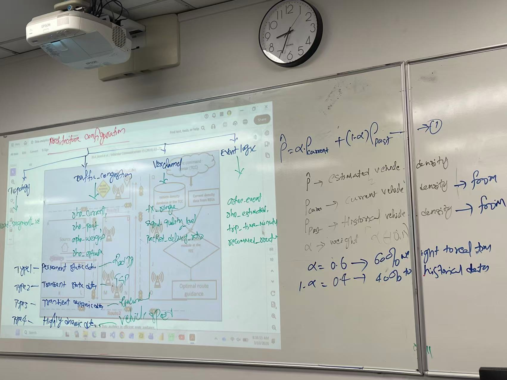
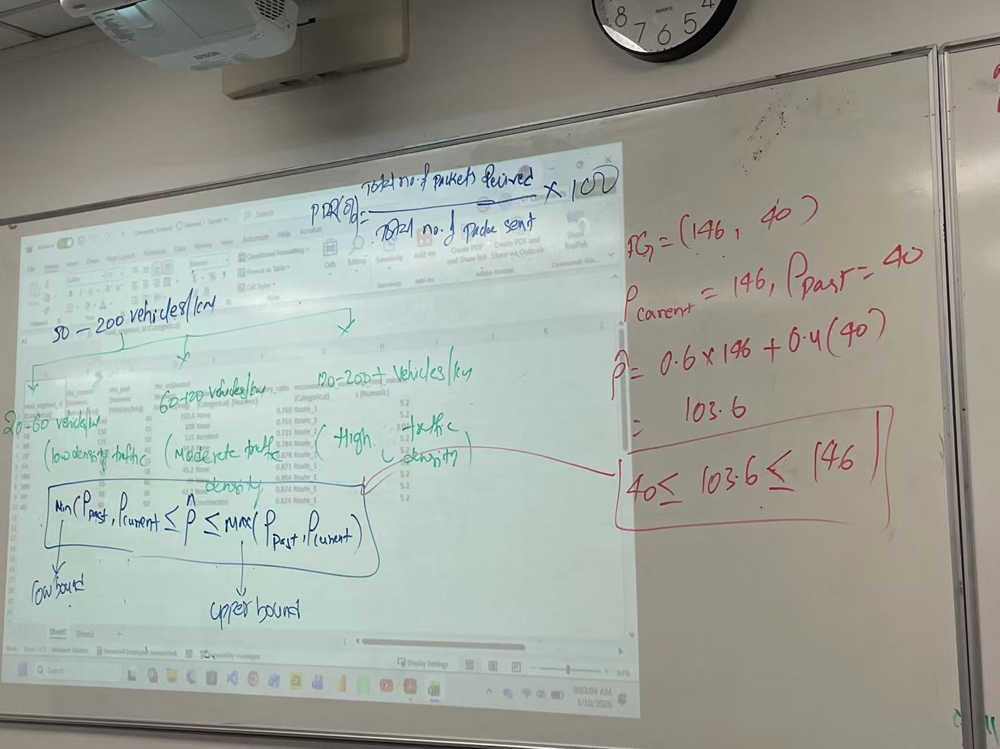
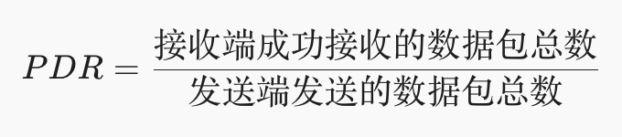

# Week10  
  
  
## ==Archetecture configuration==  
**1. 基础架构配置（Architecture Configuration）**  
* **Topology**（拓扑结构） -> **road_segment_id**（路段 ID 标识）   
* **Traffic_congestion**（交通拥堵监测） -> 对应变量：  
    * rho_current（当前密度）   
    * rho_past（历史密度）   
    * alpha_weight（权重==α==）   
    * rho_estimated（最终估算密度 ==ρ^==）   
* **V2X Channel / Communication**（通信与网联） -> 监控指标：  
    * tx_range（传输范围/发射功率控制）   
    * signal_quality_level（信号质量等级）   
    * packet_delivery_ratio（数据包到达率 PDR）   
**2. 事件响应逻辑（Event Logic）**  
* 当检测到突发事件（如事故或学校放学限制）时，触发 **active_event**（激活事件）：  
    * 计算 rho_estimated（估算密度）   
    * 估算 trip_time_minute（行程所需分钟数）   
    * 输出 recommended_route（推荐的避拥堵路线，如 Route 2）  
  
  
## ==Four Data Types==  
根据该论文（*Data analytics for Cooperative Intelligent Transport Systems*）第 2 页至第 3 页 Section 2.1 对局部动态地图（Local Dynamic Map, LDM）的定义，智能交通系统（C-ITS）中的数据主要分为以下 **4 种数据类型（Four Data Types）**：  
## 1. 第一类数据：永久静态数据 (==Type 1 Data: Permanent Static==)  
* **定义与内容**：指固定不变的地图基本信息，例如道路拓扑结构（Road Topology）、道路限速（Speed Limits）以及兴趣点（Points of Interest）等。   
* **特点**：数据长期稳定不发生改变。   
## 2. 第二类数据：瞬态静态数据 (==Type 2 Data: Transient Static==)  
* **定义与内容**：指在较长时间内保持不变、但可能会临时调整的静态设施信息，例如交通信号灯（Traffic Signals）、收费站/过路费（Toll Charges）以及临时交通标志等。   
* **特点**：属于低频变更的静态数据。   
## 3. 第三类数据：瞬态动态数据 (==Type 3 Data: Transient Dynamic==)  
* **定义与内容**：指具有时效性、会随时间和环境变化的事件与状态数据，例如道路施工（Road Works）、天气状况（Weather Conditions）、停车场空位（Parking Facilities）以及危险位置警告（Hazard Locations）等。   
* **特点**：持续时间较短，属于中等更新频率的动态数据。   
## 4. 第四类数据：高度动态数据 (==Type 4 Data: Highly Dynamic==)  
* **定义与内容**：指由车辆和路侧设备实时产生的超高频动态信息，主要通过协同意识消息（CAMs）和分散环境通知消息（DENMs）进行传输。具体包含车辆的实时速度（Vehicle Speed）、行驶方向（Vehicle Direction）、实时位置（Neighbor Positions）以及加速度（Accelerations）等。   
* **特点**：更新频率极高（例如 CAM 消息每秒生成 1 到 10 次），是保障车辆安全和实时感知的核心数据  
  
  
  
## ==Equation==  
  
在论文 *Data analytics for Cooperative Intelligent Transport Systems* 的第 7 页（Section 4.1 "Efficient route guidance application"）中，该公式定义如下：  
  
==ρ^ =αρcurrent +(1−α)ρpast==  
  
## 1. 公式背景与作用  
在协同智能交通系统（C-ITS）的路径引导（Route Guidance）应用中，交通指挥中心（TCC）需要估算特定路段的车辆密度，以判断道路是否拥堵并推荐最佳路径。  
  
如果只看“过去的历史数据”，就无法应对突然发生的事故或临时拥堵；如果只看“当前数据”，可能会受到短时间的偶然数据波动干扰。因此，该公式采用**加权求和（Weighted Summation）的方式，将路侧单元（RSU）采集到的实时（当前）车辆密度**与数据库中的**历史车辆密度**结合起来，预测出更准确的**估计车辆密度 (ρ^ )**。  
  
## 2. 变量含义拆解  
* **ρ^ （Estimated Vehicle Density / 估计车辆密度）**：  
    * TCC 最终计算出的该路段综合车辆密度估算值，用于路由算法判断路径优劣。 
  
* **ρcurrent （Current Vehicle Density / 当前车辆密度）**：== from sensor/RSU （==来自路侧单元采集的当前实时车辆密度）==）==  
    * 由路侧单元（RSU）通过车辆定期发送的 CAM（Cooperative Awareness Message）消息实时统计并上传至 TCC 的当前道路实际车辆密度。 
  
* **ρpast （Past Vehicle Density / 历史车辆密度）**：== from TCC（==来自历史数据库/交通指挥中心的历史车辆密度==）==  
    * 存储在 TCC 数据库中的历史数据，指以往在同一天、同一时间段该路段的平均车辆密度。 
  
* **α（Weight Parameter / 权重参数，取值范围 ==0≤α≤1==） -> ==α=0.6 60% weight to real time value , 40%for historical data==**：  
    * 分配给“当前车辆密度”的权重系数。   
    * (1−α) 则代表分配给“历史数据”的权重。 
  
## 3. 权重参数 α 的动态选择逻辑  
论文中特别指出，权重 α 不是固定不变的，而是由 TCC 根据**路段特性**和**一天中的具体时间**来灵活选择：  
  
1. **高波动/突发状况路段（α 取较大值）**：  
    * 如果某条道路在特定时间的车辆密度变化非常剧烈，或者发生了突发交通事故、学校放学（School Zone）等临时拥堵，TCC 会调大 α 值。这样可以**提高当前实时数据（ρcurrent ）的权重**，使系统能迅速感知并绕开突发拥堵。 
  
2. **平稳路段（α 取较小值）**：  
    * 如果道路的交通流非常稳定、日常变化不大，TCC 会调小 α 值。此时系统会**赋予历史数据（ρpast ）更高的权重**，以减少实时噪音干扰，平滑估算结果。 


  
## ==Sample==  
The vehicle density on each road section is varied from 50 vehicles/km to 200 vehicles/km.  
  
20 - 60: low density traffic density  
60 - 120: moderate traffic density  
120 - 200:high traffic density  
  
  
## ==Generate_Dataset.xlsx==  
**1. Sheet1属性逐一对照表**  

| 表格列名 (Attribute) | 数据类型 | 论文/板书中的对应来源与定义 |
| -------------------------- | --------------------- | --------------------------------------------------------------------------------------------------------------------------- |
| road_segment_id (A列) | Categorical | 论文图3（Fig. 3）中的拓扑路段：如 FG、GB、BD、DP、FH、HM、MN、NP、AD。板书中明确标注了 Topology -> road_segment_id。 |
| rho_current (B列) | Numeric (Vehicles/km) | 公式中的 $\\rho_{\\text{current}}$：来自 RSU 实时采集的当前路段车辆密度（当前车辆数/公里）。 |
| rho_past (C列) | Numeric (Vehicles/km) | 公式中的 $\\rho_{\\text{past}}$：储存在 TCC 数据库中的历史车辆密度数据。 |
| rho_estimated (D列) | Numeric (Vehicles/km) | 公式中的 $\\hat{\\rho}$：使用加权公式计算出的最终估计车辆密度 $\\hat{\\rho} = \\alpha \\rho_{\\text{current}} + (1-\\alpha) \\rho_{\\text{past}}$。 |
| active_event (E列) | Categorical | 论文 4.1 节与板书中的事件类型：论文中提到的临时突发事件，如事故 Accident（如 BD 路段）、施工/学校放学限制 Construction/School Zone 以及正常无事件 None。 |
| packet_delivery_ratio (F列) | Numeric | 论文 4.2 节与图 7 中的网络性能指标 PDR：数据包到达率（0.731 ~ 0.878），板书中记录为 V2X channel -> packet_delivery_ratio。 |
| recommended_route (G列) | Categorical | 论文图 3/图 5 与板书输出结果：路径规划系统推荐的行驶路线 Route_1（最短路径）或 Route_2（避拥堵路线）。板书记录为 recommend_route。 |
| trip_time_minutes (H列) | Numeric | 论文图 4 中的行程时间估算：完成该行程所需的总分钟数（如正常 5.2 分钟，选择 Route_2 时为 3.02 分钟）。板书记录为 trip_time_minute。 |
  
  
## ==PDR==  
在通信与智能交通系统（ITS）中，**PDR** 是 **Packet Delivery Ratio** 的缩写，中文通常翻译为 **数据包到达率** 或 **数据包交付率**。  
以下是关于 PDR 的核心解释：  
**1. 定义与计算公式**  
**PDR（Packet Delivery Ratio）** 指在无线通信网络中，接收端成功接收到的数据包数量与发送端所发送的数据包总数量的比值。  
  
其数值范围在 **0 到 1** 之间（或以百分比 **0% - 100%** 表示）。数值越接近 1（100%），说明通信质量和可靠性越高。  
  
### ==min( Ppast, Pcurrent =< ρ^ =<Max(Ppast,Pcurrent))==  
  
PG=(146,40)  
Pcurrent=146,Ppast=40  
### ==ρ^=0.6*146+0.4*40 =103.6 ==  
  
==(Lowbound) 40 < ρ^ 103.6  < (Upper bound )146==  
  
==详细解读：==  
## 一、 右侧白板：FG 路段的具体计算代入与数值约束（红/紫字）  
老师以 Excel 数据集中的第一行 **FG 路段** 为例，代入公式进行了完整示范：  
**1. 提取已知数据**  
* **$FG = (146, 40)$**：代表 FG 路段的实时车辆密度与历史车辆密度。   
    * **$\rho_{\text{current}} = 146\text{ vehicles/km}$**（实时车辆密度）   
    * **$\rho_{\text{past}} = 40\text{ vehicles/km}$**（历史车辆密度）   
**2. 代入估计公式**  
* **公式**：$\hat{\rho} = \alpha \cdot \rho_{\text{current}} + (1 - \alpha) \cdot \rho_{\text{past}}$
  
* **代入计算**（假设设定权重系数 $\alpha = 0.6$，即历史权重 $1-\alpha = 0.4$）： 
$$\hat{\rho} = 0.6 \times 146 + 0.4 \times (40) = 87.6 + 16 = 103.6\text{ vehicles/km}$$

(计算结果完全对应 Excel 中 FG 路段的 rho_estimated = 103.6)   
**3. 红框中的数学边界约束（Mathematical Bound）**  
* **表达式**：$40 \le 103.6 \le 146$
  
* **逻辑说明**：因为权重 $\alpha \in [0, 1]$，采用加权平均（凸组合 Convex Combination）计算出的预测值 $\hat{\rho}$ **必定落在历史数据和实时数据的最小值与最大值之间**。   
## 二、 投影仪中央：估算值的上下界原理（蓝字推导）  
在 Excel 表格下方，老师写下了更通用的加权边界推导公式：  
  
* **low bound（下界）**：$\min(\rho_{\text{past}}, \rho_{\text{current}})$ $\rightarrow$ 预测密度 $\hat{\rho}$ 不会低于历史与实时的最小值。   
* **upper bound（上界）**：$\max(\rho_{\text{past}}, \rho_{\text{current}})$ $\rightarrow$ 预测密度 $\hat{\rho}$ 也绝不会高于历史与实时的最大值。   
## 三、 投影仪上方与左侧：交通密度分级与 PDR 定义（绿色标注）  
**1. 整体车辆密度采样范围**  
* **50 - 200 vehicles/km**：这是论文实验中设定的总体车辆密度变化区间（与论文 Section 4.1 表 3 处的参数说明完全符合）。   
**2. 三级交通拥堵状态分类（Traffic Density Classification）**  
老师将车辆密度进一步细分为三个级别：  
1. **低密度 / 畅通状态**：**20 - 60 vehicles/km** $\rightarrow$ **Low density traffic**
  
2. **中密度 / 轻度拥堵**：**60 - 120 vehicles/km** -> **Moderate traffic density**（FG 路段算出的 103.6 正好属于此区间）   
3. **高密度 / 严重拥堵**：**120 - 200+ vehicles/km** -> **High traffic density**（例如发生事故 BD 路段的 125/175，会触发路由切换为 Route 2）   
**3. PDR 数据包到达率公式**  
在顶部写出了 **PDR（Packet Delivery Ratio）** 的标准计算百分比公式：  
$$\text{PDR}(\%) = \frac{\text{Total no. of packets received}}{\text{Total no. of packets sent}} \times 100$$  
  
* **含义**：即“接收到的总数据包数”除以“发送的总数据包数”再乘以 100%。   
  
## ==Sheet2:==  
**Sheet2** 的表格是 **Sheet1（截面数据）在时间维度上的扩展**，也就是一个标准的 **时间序列动态数据集（Time-Series Dynamic Dataset）**。  
理解 Sheet2 的核心在于看懂第一列新增的 **time_step（时间步）** 以及系统随时间变化的**动态决策过程**。以下是详细理解指南：  
## 1. 核心变化：引入时间维度 (time_step)  
* **time_step (A列)**：代表仿真运行的时间进度（例如以分钟为单位，每 5 分钟采样一次：5, 10, 15, 20...）。   
* **数据结构**：  
    * **第 2–10 行**：时间步为 **5**（即第 5 分钟时，全网 9 个路段的交通与通信状态）。   
    * **第 11–19 行**：时间步为 **10**（第 10 分钟时，各路段的最新状态）。   
    * **第 20–28 行**：时间步为 **15**，以此类推。   
这说明系统不是只评估一次，而是在持续监测（Continuous Monitoring）整个交通网络的变化。  
## 2. 各字段的动态演变规律  
**① 车辆密度的动态波动 (rho_current & rho_estimated)**  
* **历史密度 (rho_past) 保持不变**：对于同一路段（如 BD 路段的 rho_past = 50），数据库中的历史均值是固定的。   
* **实时密度 (rho_current) 随时间上下波动**：  
    * 例如 **BD 路段**：  
        * $t = 5$ 分钟时，rho_current = **175** -> rho_estimated = **125**
  
        * $t = 10$ 分钟时，rho_current 稍微降至 **173** ->  rho_estimated = **123.8**
  
        * $t = 20$ 分钟时，rho_current 进一步升至 **179** ->  rho_estimated = **127.4**
  
**② 通信质量与拥堵的负相关性 (packet_delivery_ratio)**  
随着车辆密度的增加，无线信道干扰变大，数据包到达率（PDR）呈现**动态下降**趋势：  
* 以 **BD 路段** 为例：  
    * $t = 10$ 分钟时（rho_estimated = 123.8），PDR 为 **0.733**。   
    * $t = 20$ 分钟时（rho_estimated 升至 127.4，拥堵加剧），PDR 进一步降至 **0.727**。   
**③ 实时推荐路由的逻辑判别 (recommended_route)**  
系统根据公式 =IF(rho_estimated > 120, "Route_2", "Route_1") 在每个时间步实时计算：  
* **BD 路段**：在所有时间步中（t=5, 10, 15, 20），其估计密度 rho_estimated 始终大于 120（分别为 125, 123.8, 125, 127.4），因此系统在**整个时间段内一直持续推荐 Route_2**。   
* **其他路段（如 FG, GB, DP 等）**：估计密度虽然在波动（如 FG 在 103.6 到 113.2 之间），但始终没有超过 120，因此一直维持推荐 **Route_1**。   
## 总结：Sheet2 的应用场景  
* **Sheet1** 展示的是**单一时刻**各路段的静态对比。   
* **Sheet2** 展示的是**连续时间段内**各路段的动态追踪。这种数据结构可以直接用于**机器学习中的时间序列预测（Time-Series Forecasting）**（例如用 LSTM 或 Transformer 预测未来第 30 分钟路段是否会过载）或**强化学习/Agentic AI 的虚拟环境搭建**。  
  
  
  
  
