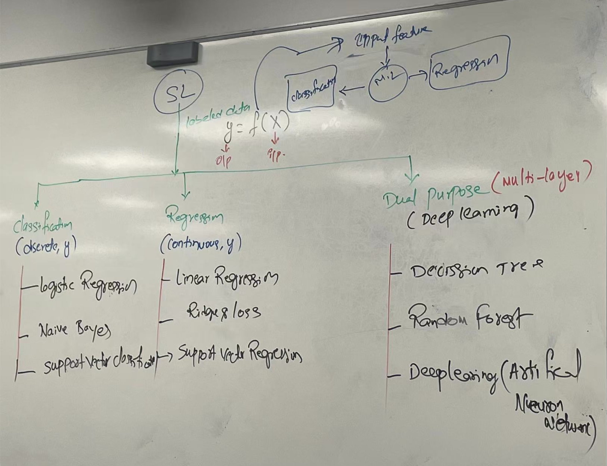

# Week 11  
#   
根据机器学习的定义，判断一个字段是属于 **Classification（分类）** 还是 **Regression（回归）**，取决于当该字段作为预测目标（Target Variable, y）时，它的数据类型是**离散的类别（Discrete）还是连续的数值（Continuous）**。  
  
## 一、 顶部核心定义与公式 (Top Section)  
1. **核心圈层**: **SL**（Supervised Learning，监督学习）   
2. **训练基础**: **labeled data**（有标签数据，即同时包含输入和真实标签）   
3. **数学表达式**:
$$y = f(X)$$
  
    * **X** $\rightarrow$ 指向顶部箭头标为 **input feature**（输入特征 / 自变量）。  
    * **y** $\rightarrow$ 指向下方箭头标为 **o/p**（Output，输出目标 / 标签）。  
    * **f** $\rightarrow$ 指向右侧箭头标为 **m.l**（Machine Learning Model，机器学习模型/映射函数）。  
4. **模型两大预测任务**:  
    * **m.l**（模型）向左指向 **classification**（分类）   
    * **m.l**（模型）向右指向 **regression**（回归）   
    *   
## 二、 底部三大算法分支 (Three Main Branches)  
板书底部从上方的 **SL** 引出三条下行分支，分别代表三大类算法体系：  
**==1. 第一分支（左侧）：Classification (discrete, y)==**  
* **定义**: **分类任务**，其输出变量 $y$ 为**离散值 (discrete)**。   
* **包含算法**:  
    1. **logistic Regression**（逻辑回归）   
    2. **Naive Bayes**（朴素贝叶斯）  
    3. **support Vector classification**（支持向量分类器，SVC）   
**==2. 第二分支（中间）：Regression (continuous, y)==**  
* **定义**: **回归任务**，其输出变量 $y$ 为**连续数值 (continuous)**。   
* **包含算法**:  
    1. **Linear Regression**（线性回归）   
    2. **Ridge & Lasso**（岭回归与 Lasso 回归）  
    3. **Support Vector Regression**（支持向量回归，SVR）  
  
**==3. 第三分支（右侧）：Dual purpose (multi-layer) (Deep learning)==**  
* **定义与核心特点**:  
    * **Dual purpose**（双重用途）：同一模型结构既能用于 Classification（分类），又能用于 Regression（回归）。   
    * **multi-layer**（多层架构）：底层由多层决策节点或多层神经元叠加而成。   
* **包含算法**:  
    1. **Decision Tree**（决策树）   
    2. **Random Forest**（随机森林）   
    3. **Deep learning (Artificial Neuron Network)**（深度学习 / 人工神经网络）   
  
  
# 总结（分类与回归汇总表）  

| 字段名称 (FieldName) | 数据属性类型 (Type) | ML 任务归类 (Classification vs Regression) | 典型应用场景
 |
| ------------------------ | ----------------- | -------------------------------------- | -------------- |
| recommended_route

 | Categorical (离散)
 | Classification (分类)

 | 预测是否需要改变路线重定向
 |
| active_event

 | Categorical (离散)
 | Classification (分类)

 | 预测/识别路段事件类型
 |
| road_segment_id

 | Categorical (离散)
 | Classification (分类)

 | 路段空间分类特征
 |
| rho_estimated

 | Numeric (连续)
 | Regression (回归)

 | 预测估计车辆密度 ρ^

 |
| trip_time_minutes

 | Numeric (连续)
 | Regression (回归)

 | 预测行程到达时间（ETA）
 |
| packet_delivery_ratio

 | Numeric (连续)
 | Regression (回归)

 | 预测通信信道 PDR 质量
 |
| rho_current / rho_past

 | Numeric (连续)
 | Regression (回归)

 | 测量与预测交通流密度
 |
  
  
==Phase1 Google colab==  
    - [ ] ==S1 uploading dataset==  
    - [ ] ==S2 Classification==  
    - [ ] ==S2 Regression==  
    - [ ] ==S3 DeepLearning (ANN)==  
  
==Phase2 Power BI==  
==Visualization (Classification, Regression, DL)==  
  
  
# Python中的lib  
## 1. NumPy（Numerical Python）—— 底层高性能数值计算库  
* **核心职责**：**底层矩阵与多维数组计算（==Numerical Computing & Array Operations==）**。   
* **主要功能**：  
    * 提供了高性能的多维数组结构 ndarray（比 Python 原生列表快几十到上百倍）。   
    * 包含大量的数学函数，用于线性代数（矩阵乘法）、向量化计算、随机数生成以及开方、对数等高级数学运算。   
* **形象比喻**：它是整个 Python 数据科学生态的“发动机”（Pandas 和 Scikit-learn 等上层库都是构建在 NumPy 之上的）。   
## 2. Pandas（Python Data Analysis Library）—— 数据清洗与表格处理库  
* **核心职责**：**数据处理、清洗与表格操作（==Data Processing & Manipulation==）**。   
* **主要功能**：  
    * 提供了类似 Excel 表格的二维数据结构 DataFrame。   
    * 用于读取 CSV、Excel、数据库数据。   
    * 负责缺失值处理、数据过滤、列计算、数据透视表（pivot_table） 以及按条件分组聚合（groupby）。   
* **形象比喻**：它是 Python 版本的“代码化 Excel”，是日常处理结构化表格数据的核心工具。   
## 3. Matplotlib —— 基础数据可视化画板  
* **核心职责**：**基础数据可视化（==Data Visualization / Base Plotting==）**。   
* **主要功能**：  
    * Python 最底层、最古老也是最强大的作图库。   
    * 可以绘制折线图、柱状图、散点图、饼图等基础图表。   
    * 提供了对图表极其精细的控制能力（如调整画布大小 figsize、坐标轴标签 xlabel/ylabel、图例 legend 和标题 title）。   
* **形象比喻**：它就像一张“空白的画板”，你需要手把手画出图表中的每一个线条和元素。   
## 4. Seaborn —— 高级统计图形可视化库  
* **核心职责**：**高级统计数据可视化（==Statistical Data Visualization==）**。   
* **主要功能**：  
    * **基于 Matplotlib 做了高级封装**，只需要一行代码就能画出极具美感、符合发表标准的统计图表。   
    * 内置漂亮的配色方案（Palettes）和主题样式（如 whitegrid）。   
    * 擅长绘制高级统计图，如热力图（Heatmap）、箱线图（Boxplot）、带置信区间的回归折线图以及分类条形图（如 sns.barplot）。   
* **形象比喻**：它就像是给 Matplotlib 画板配上了“美化滤镜与高级自动化插件”，几行代码就能做出专业的 Dashboard 图表。   
## 💡 总结与它们之间的工作联动关系  
  
在典型的数据分析项目中，这四个库通常配合使用：  
Python  
  
import numpy as np         # 1. 负责底层的快速数学运算  
import pandas as pd        # 2. 负责读取 Excel/CSV，清洗并处理表格数据  
import matplotlib.pyplot as plt # 3. 负责搭建绘图画布 (fig, ax) 和调整细节  
import seaborn as sns      # 4. 负责调用高级 API 快速绘制美观的统计图表  
  
