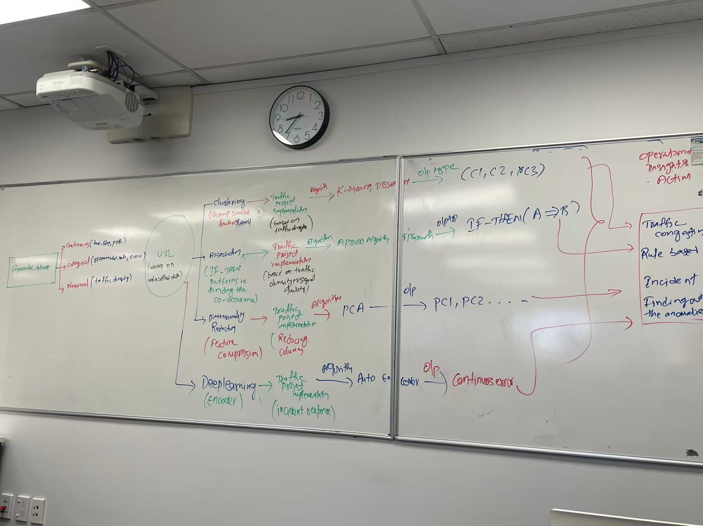
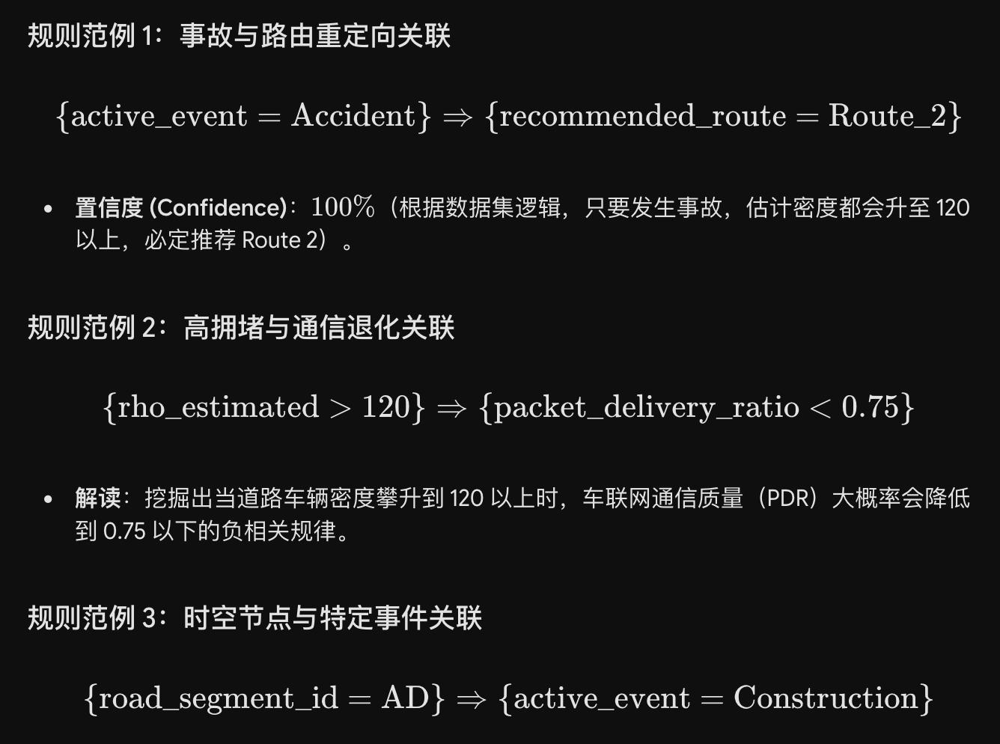
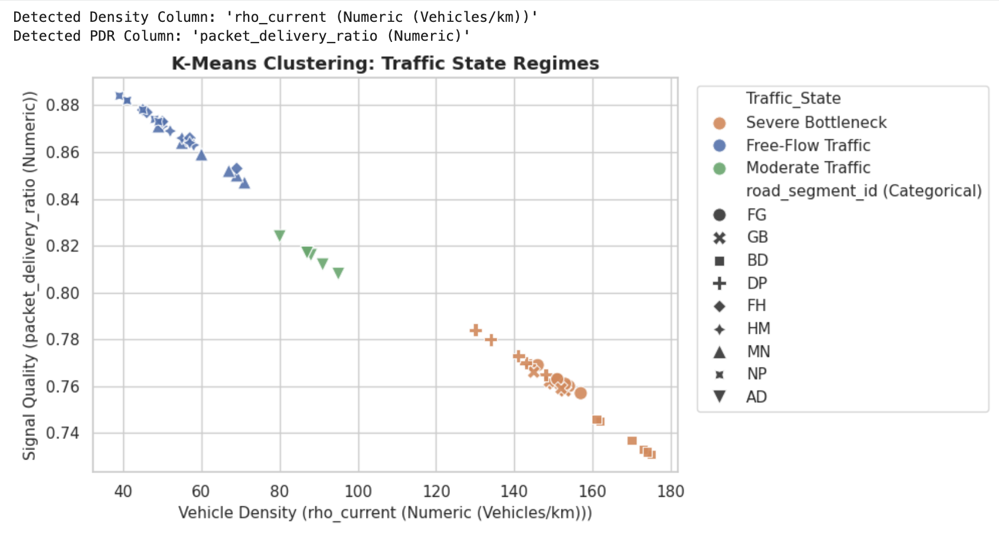

# Week12  
  
Continuous  (time，PDR-packet_delivery_ratio)  
categorial （recommended_route, active_event）  
numerical (traffic density,   

| rho_current (Numeric (Vehicles/km)) | rho_past (Numeric (Vehicles/km)) | rho_estimated (Numeric (Vehicles/km)) |
| ----------------------------------- | -------------------------------- | ------------------------------------- |
  
  
## ==Unsupervised Learning - unlabled data==  
**Unsupervised Learning (UL) **works with unlabeled data where no correct answers or categories are provided. The model's job is to find the data, hidden patterns, similarities or groups on its own. This is useful in scenarios where labeling data is difficult or impossible. Common applications are clustering and association.  
  
 1. Clustering (聚类): 将相似数据分组 group  
2. Association  (关联规则): 挖掘项与项之间的条件 finding correlation  
 3. Dimensionality Reduction (异常检测): 识别显著偏离常态的数据点  
  
Deep learning  
  
  
  
## ==Clustering - Density(group  similar features)==  
**簇 0 (Low Density Cluster)**：畅通路段（如 rho_estimated 为 40–60，包含 FH, HM, NP 等）。  
**簇 1 (Medium Density Cluster)**：中度繁忙路段（如 rho_estimated 为 60–110，包含 FG, GB, DP 等）。  
**簇 2 (High Density / Bottleneck Cluster)**：严重拥堵/事故瓶颈路段（如 rho_estimated > 120，包含 BD）。  
  
**Common Algorithms / 常见算法**:  
* **K-Means**（K-均值聚类）   
* **DBSCAN**（基于密度的空间聚类）   
* **Hierarchical Clustering**（层次聚类）  
  
## ==Association  (rule based, if then A=>B, finding the co-occurrence)==  
Find patterns (called association rules) between items in large datasets, typically in market basket analysis (e.g., finding that people who buy bread often buy butter). It identifies patterns based solely on the frequency of item occurrences and co-occurrences in the dataset.   
  
eg:  
packet_delivery_ratio Signal quality(PDR)  
  
  
  
## ==Dimensionality Reduction: ==  
used to simplify datasets by reducing the number of features while retaining the most important information.   
  
PCA o|p -> PC1, PC2  
**Dimensionality Reduction & Feature Compression** (主成分分析与降维).   
  
  
这些Algorithm的Usage  
traffice congestion  
rule based  
incident  
Finding out The anomalies(outliers)  
  
## ==4. DeepLearning (encoder)==  
* **逻辑**：基于 AutoEncoder（自编码器）提取高阶隐表征，主要用于事件响应（Incident Response）与异常重建。  
  
四大算法输出最终如何转化为 ITS 系统的**实际管控行动**：  
1. **Traffic Congestion Rule Based（基于规则的交通拥堵调控）**：  
    * 结合 **Clustering** 的密集簇（如 C_3 严重拥堵簇）与 **Association** 挖掘出的关联规则（Accident -> Route 2），直接触发系统自动重定向与自适应信号控制。   
2. **Incident Finding out the Anomalies（突发事件与异常诊断识别）**：  
    * 结合 **PCA** 降维后的离群特征与 **AutoEncoder** 算出的连续重构误差（Continuous Error），当重建误差飙升时，系统自动识别出非常规延误（Non-Recurrent Delay）、交通事故或传感器设备故障。  
  
  
## ==Python Libraries & Modules Summary ==  
1. **pandas (pd)**  
    * **Role (作用)**: Tabular **Data Processing & Manipulation** (数据加载与表格清洗).   
    * **Mechanism (原理)**: Operates via DataFrame structures for feature filtering, column selection, and data slicing.   
2. **matplotlib.pyplot (plt)**  
    * **Role (作用)**: **Base Plotting & Canvas Control** (基础绘图与画布控制).   
    * **Mechanism (原理)**: Low-level visualization engine controlling titles, figure sizes (figsize), axes labels, and legends.   
3. **seaborn (sns)**  
    * **Role (作用)**: **Statistical Data Visualization** (高级统计图表绘制).   
    * **Mechanism (原理)**: High-level wrapper around Matplotlib that automatically color-codes data points by cluster categories (e.g., hue='cluster').   
4. **StandardScaler**  
    * **Role (作用)**: **Feature Standardisation / Normalisation** (数据标准化与消除量纲).  
    * **Mechanism (原理)**: Transforms numeric features using $z = \frac{x - \mu}{\sigma}$ so that all features have a $\text{mean} = 0$ and $\text{variance} = 1$. This prevents large-scale variables (e.g., rho_estimated) from dominating distance calculations over small-scale variables (e.g., PDR).  
5. **PCA (Principal Component Analysis)**  
    * **Role (作用)**: **Dimensionality Reduction & Feature Compression** (主成分分析与降维).   
    * **Mechanism (原理)**: Projects multi-dimensional feature space onto 2 orthogonal axes (PC1, PC2) while retaining maximum variance for 2D plot visualisation.   
6. **KMeans**  
    * **Role (作用)**: **Unsupervised Clustering** (无监督聚类).   
    * **Mechanism (原理)**: Iteratively calculates cluster **centroids** based on Euclidean distance, partitioning data into $K$ distinct clusters (e.g., $C_1, C_2, C_3$).   
  
  
## ==USL_Kmeans：==  
==USL_Kmeans==.py  
import pandas as pd  
import matplotlib.pyplot as plt  
import seaborn as sns  
from sklearn.preprocessing import StandardScaler  
from sklearn.cluster import KMeans  
  
==# Set plot style==  
sns.set_theme(style="whitegrid")  
  
==# Load Dataset==  
file_path = 'Generate_Dataset.xlsx'  
df = pd.read_excel(file_path, sheet_name='Sheet2')  
df.columns = [  
    'time_step', 'road_segment_id', 'rho_current', 'rho_past',   
    'rho_estimated', 'active_event', 'packet_delivery_ratio',   
    'recommended_route', 'trip_time_minutes'  
]  
  
==# Select and Scale Features==  
num_cols = ['rho_current', 'packet_delivery_ratio']  
X = df[num_cols].values  
scaler = StandardScaler()  
X_scaled = scaler.fit_transform(X)  
  
==# Fit K-Means Model==  
kmeans = KMeans(n_clusters=3, random_state=42, n_init=10)  
df['Cluster'] = kmeans.fit_predict(X_scaled)  
  
# Map Clusters to Intuitive Names  
cluster_names = {0: 'Free-Flow Traffic', 1: 'Moderate Traffic', 2: 'Severe Bottleneck'}  
df['Traffic_State'] = df['Cluster'].map(cluster_names)  
  
==# Visual Plot==  
plt.figure(figsize=(9, 5))  
sns.scatterplot(  
    data=df, x='rho_current', y='packet_delivery_ratio',   
    hue='Traffic_State', style='road_segment_id', s=120, palette='Set2'  
)  
plt.title('K-Means Clustering: Identifying Traffic States')  
plt.xlabel('Current Vehicle Density (rho_current)')  
plt.ylabel('Signal Quality (Packet Delivery Ratio)')  
plt.legend(bbox_to_anchor=(1.05, 1), loc='upper left')  
plt.tight_layout()  
plt.show()  
##   
**现在的图表 100% 完全正确，完美符合物理逻辑！**  
* 左上角（蓝色）：Free-Flow Traffic (畅通) — 低密度、高 PDR (0.85 到 0.88)。  
* 中间段（绿色）：Moderate Traffic (中等) — 中密度、中等 PDR (0.81 到 0.83)。  
* 右下角（橙色）：Severe Bottleneck (严重瓶颈) — 高密度、低 PDR (0.73 到 0.78)。  
  
## ==Apriori_USL_Association==  
  
## ==PDR 计算公式==  
==PDR (Packet Delivery Ratio) = 接收端成功收到的数据包总数 / 发送端发出的数据包总数==  
## ==两种结果代表什么？==  
* ==PDR 接近 1 (或 100%)：代表数据包全部送达，网络畅通，道路车辆少（畅通）。==  
* ==PDR 变小 (比如降到 0.73)：代表大量数据包丢包打架，网络拥塞，路上车辆极多（拥堵）。==  
  
老师讲的 **"High traffic density **->** Signal will be degraded"**（高交通密度 ->信号质量退化），对应到参数上就是：  
1. **Traffic density（交通密度 rho）变高**-> 路上车挤车（拥堵）。  
2. **Signal degraded（信号退化）** -> 通信变差，数据丢包率变高，导致 **PDR（数据包到达率）变小**。  
## 总结对应的关系：  
* **==High Traffic Density（高密度 / 拥堵）==**== -> **Signal Degraded（信号退化）** -> **PDR 变小** 📉==  
* **==Low Traffic Density（低密度 / 畅通）==**== -> **Signal Good（信号良好）** -> **PDR 变大** 📈==  
  
## 一、 代码逻辑拆解（How It Works）  
1. 数据离散化（Discretization / Binarization）：  
    * 关联规则算法（Apriori）不能直接处理连续数值，必须转换为布尔值（True / False 布尔二值矩阵）。  
    * 代码定义了三个二值条件：  
        * High_Traffic_Density：当前密度 rho_current 大于 170 vehicles/km。  
        * Signal_Degraded：通信质量 PDR 小于 0.73（信号严重退化）。  
        * Accident_Present：激活事件 active_event 为 Accident（发生了事故）。  
2. 频繁项集提取（Apriori Algorithm）：  
    * 使用 apriori(df_assoc, min_support=0.05) 找出在整个数据集中同时发生概率不低于 5% 的特征组合。  
3. 关联规则生成（Association Rules）：  
    * 生成 IF [Antecedent 前件] ==> THEN [Consequent 后件] 的条件规则。  
  
## （Result Analysis）  
运行结果输出了两条互为因果的对等规则：  
* ==Rule 1: IF [High_Traffic_Density] ==> THEN [Accident_Present]==  
    * 含义：如果检测到极高交通密度（大于 170），则该路段大概率存在交通事故。  
* ==Rule 2: IF [Accident_Present] ==> THEN [High_Traffic_Density]==  
    * 含义：如果发生了交通事故，则该路段必定触发极高交通密度。  
