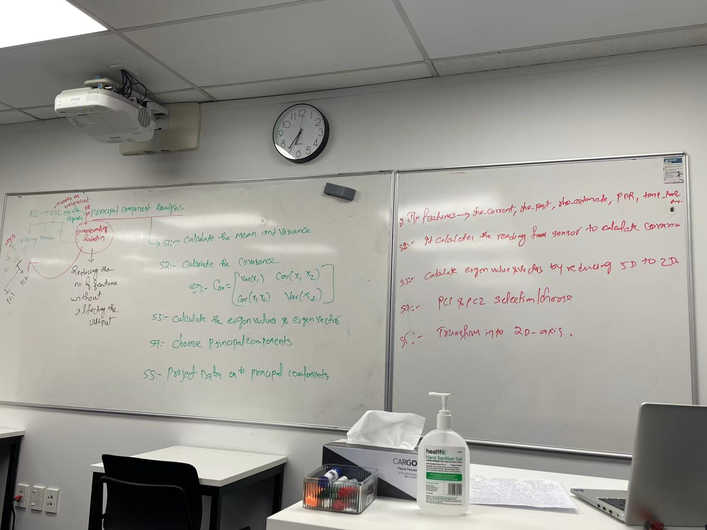
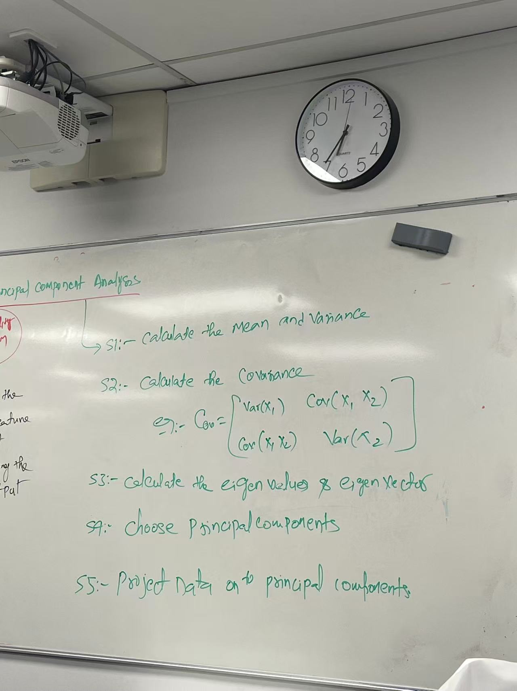
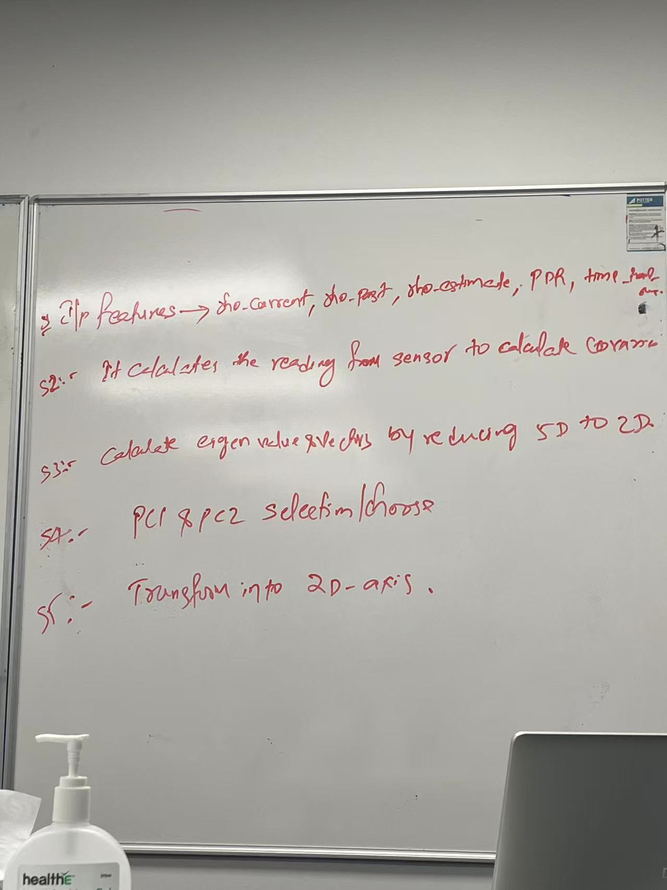
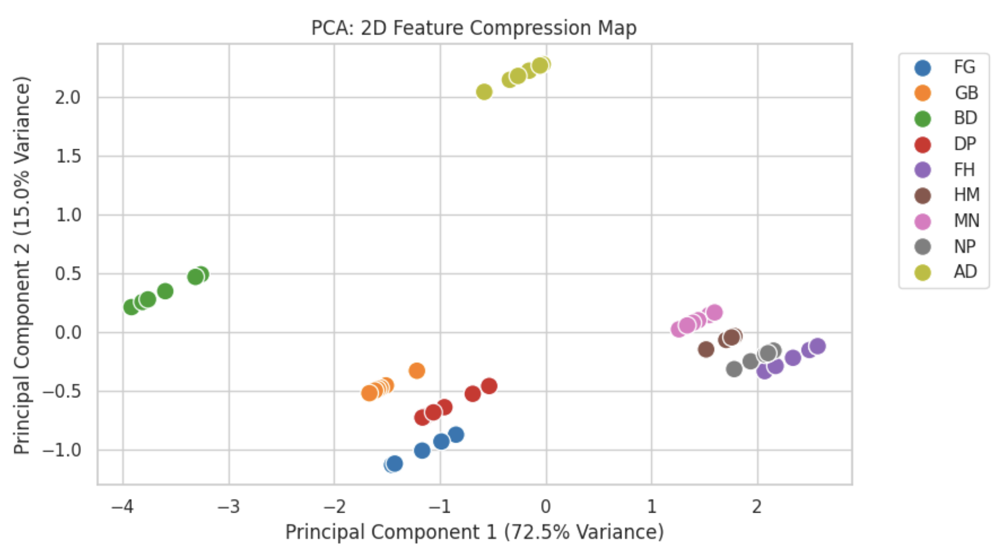
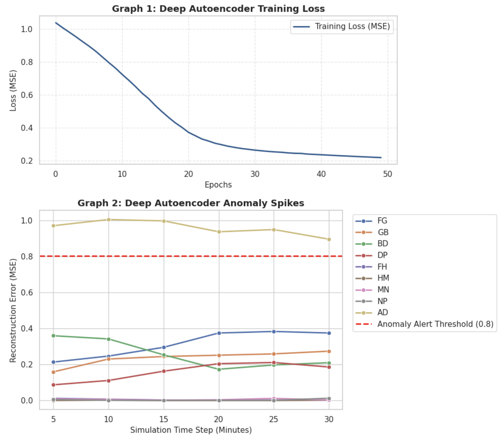
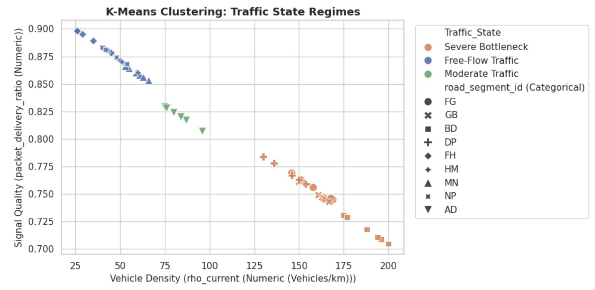
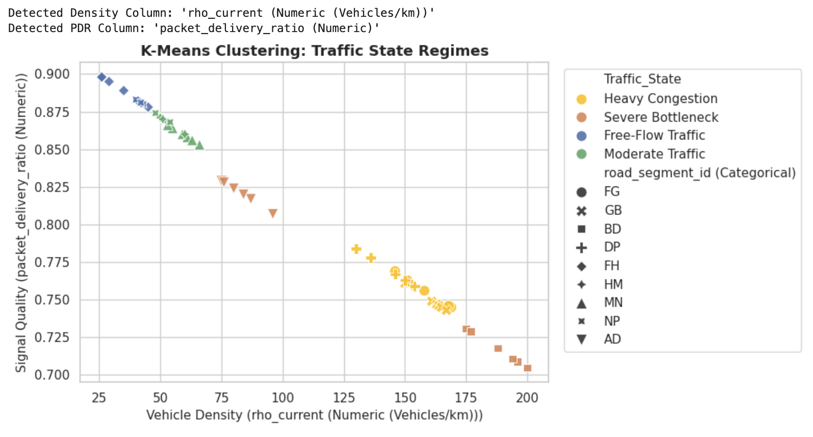

# Week13  
  
# ==Principle component analysis （PCA） ==  
## 一 PCA 是一种无监督学习（USL）的降维（Dimensionality Reduction）技术。  
Reducing the number of feature without affecting the output  
  
## 二、 核心作用与原理解释  
* **作用**：当你的数据集包含很多列特征（比如 4-5 个以上的连续数值列）时，无法直接画出平面图。PCA 可以把多维数据“压缩”成 2 个相互正交的新变量：**PC1（第一主成分）** 和 **PC2（第二主成分）**。  
* **原理**：在尽量保留原始数据最大方差（信息量）的前提下，将高维数据投影到二维平面上，方便用 2D 散点图可视化聚类结果。  
## 三、 在课程 Python 工作流中的位置  
数据加载 (pandas) -> 标准化 (StandardScaler) -> 聚类 (KMeans) -> **降维 (PCA)** -> 绘图 (seaborn/matplotlib)  
  
  
S1 - Calculate the **==Mean==** (均值) of each feature dimension.   
S2 - Calculate the **==Covariance== Matrix** (协方差矩阵) to check feature correlations.   
S3 - Compute **==Eigenvalues and Eigenvectors==** (特征值与特征向量) from the covariance matrix.   
S4 - Sort and **==select==** the top **==Principal Components==** (主成分，如 ==PC1, PC2==) based on the highest variance.   
S5 - **==Project==** (投影) the original high-dimensional data onto the new ==lower-dimensional== subspace(eg:2D axis).  
  
## ==5 features （from sensor） - use PCA to reduce dimension to 2D axis==  
rho_current (Numeric (Vehicles/km))  
rho_past (Numeric (Vehicles/km))  
rho_estimated (Numeric (Vehicles/km))  
packet_delivery_ratio (Numeric)  
trip_time_minutes (Numeric)  
  
  
  
  
PCA.py  
import pandas as pd  
import matplotlib.pyplot as plt  
import seaborn as sns  
from sklearn.preprocessing import StandardScaler  
from sklearn.decomposition import PCA  
  
==# Set plot style==  
sns.set_theme(style="whitegrid")  
  
# 1. Load Dataset & Rename columns  
file_path = 'Generate_Dataset.xlsx'  
df = pd.read_excel(file_path, sheet_name='Sheet2')  
df.columns = [  
    'time_step', 'road_segment_id', 'rho_current', 'rho_past',   
    'rho_estimated', 'active_event', 'packet_delivery_ratio',   
    'recommended_route', 'trip_time_minutes'  
]  
  
==# 2. Select Multiple Numeric Features (High-Dimensional Space)==  
num_cols = ['rho_current', 'rho_past', 'rho_estimated', 'packet_delivery_ratio', 'trip_time_minutes']  
X = df[num_cols].values  
  
==# 3. Standardize Features (Z-score Normalization)==  
scaler = StandardScaler()  
X_scaled = scaler.fit_transform(X)  
  
==# 4. Apply PCA to Compress Dimensions down to 2 Components (PC1 & PC2)==  
pca = PCA(n_components=2)  
X_pca = pca.fit_transform(X_scaled)  
  
# Store Principal Components back to DataFrame  
df['PC1'] = X_pca[:, 0]  
df['PC2'] = X_pca[:, 1]  
  
==# 5. Visual Plot: 2D Projection of Multi-Feature C-ITS Data==  
plt.figure(figsize=(9, 5))  
sns.scatterplot(  
    data=df, x='PC1', y='PC2',   
    hue='road_segment_id', s=130, palette='tab10'  
)  
plt.title('PCA: 2D Feature Compression Map')  
# Display explained variance percentage dynamically on axes  
plt.xlabel(f'Principal Component 1 ({pca.explained_variance_ratio_[0]*100:.1f}% Variance)')  
plt.ylabel(f'Principal Component 2 ({pca.explained_variance_ratio_[1]*100:.1f}% Variance)')  
plt.legend(bbox_to_anchor=(1.02, 1), loc='upper left')  
plt.tight_layout()  
plt.show()  
  
  
## 一、 方差保留率 (Explained Variance Ratio)  
* **PC1 (72.5% Variance)**：第一主成分，主要代表交通密度与拥堵程度。  
* **PC2 (15.0% Variance)**：第二主成分，主要代表通信质量（PDR）。  
* **总保留率**：==前两维共保留了 **87.5%** 的原始信息，降维效果极佳==。  
  
## 二、 图中各大路段簇群的物理含义 (Cluster Interpretation)  
1. **BD 路段（左侧绿色孤立簇）**：  
    * 特征：PC1 处于极左（-4 到 -3 ）。  
    * 物理含义：代表发生严重事故、车辆密度极高、通信严重退化的Severe Bottleneck（严重瓶颈）状态。  
2. **AD 路段（顶部黄色孤立簇）**：  
    * 特征：PC2 处于最高处（+2.0 以上）。  
    * 物理含义：代表发生道路施工（Construction）的**中度拥堵/事件路段**，在第二主成分上呈现出独特的特征隔离。  
3. **FG, GB, DP 路段（下方蓝色、橙色、红色簇群）**：  
    * 特征：PC1 与 PC2 均处于中低负值区。  
    * 物理含义：代表主干道或常规流量状态下的路段。  
4. **FH, HM, MN, NP 路段（右侧紫色、棕色、粉色、灰色簇群）**：  
    * 特征：PC1 处于正值区（+1 到 +2 ）。  
    * 物理含义：代表车流稀疏、信道畅通的Free-Flow Traffic（自由流/支路）常态路段。  
  
  
——————————————————————————————  
# ==Deep Learning==  
  
**一、**深度学习（Deep Learning）是以**人工神经网络（==ANN, Artificial Neural Networks==）为基础的机器学习分支。它通过多层（Multi-layer）非线性变换，能够实现对高维复杂交通数据（如时空轨迹、视频监控、多维遥测传感器流）的端到端自动特征提取（End-to-End Feature Learning）**。  
  
## 二、 用自编码器（Autoencoder / Encoder）来实现 ITS 交通任务的 5 个步骤   
**==Step 1: Input Layer & Feature Extraction (输入层与特征提取) -> i|p features -> rho_current，rho_past，rho_estimated，packet_delivery_ratio，trip_time_minutes==**  
* 将 C-ITS 数据集中提取的多维连续数值特征（如 rho_current, rho_past, rho_estimated, packet_delivery_ratio, trip_time_minutes）输入到神经网络的 **Input Layer** 中，完成原始交通遥测数据的初始表征与特征提取。   
**Step 2:== Feature Standardization== (数据标准化与归一化) ==-> calculate the reading from sensor to calculate c?==**  
* 使用 StandardScaler 对输入特征进行 $Z$-score 归一化处理，消除量纲差异，确保神经网络在训练时能够平稳收敛。   
**Step 3: ==Encoder Dimensionality Reduction ==(编码器降维与非线性压缩) —> ==compare the patterns in hidden layer as encoder==**  
* 通过多层隐藏层（Hidden Layers，带有 ReLU 等非线性激活函数）逐层压缩神经元数量，将高维交通特征非线性映射并压缩到低维的 **Bottleneck Layer (Latent Representation / 编码器输出)**。   
**==Step 4: Decoder Reconstruction & Loss Optimization (解码器重建与损失优化)  —> expands the 2 comp? data==**  
* 通过 **Decoder（解码器）** 接收来自编码器的低维隐变量，尝试将其还原（Reconstruct）为原始的交通特征数据；同时计算输入与还原结果之间的 **Reconstruction Error (重构误差，如 MSE)**，并通过反向传播优化网络参数。   
**Step 5: Anomaly Detection & Incident Response (异常检测与事故事件响应) —> ==matches the s i|p data==**  
* 监控输出的 **Continuous Error（连续重构误差）**。当某路段（如 BD 发生事故或设备异常）导致重构误差显著飙升时，系统自动识别出异常，触发 TCC 指挥中心的事件响应。   
  
  
  
  
## Analysis of Visual Outputs)  
**Graph 1: Deep Autoencoder Training Loss (模型训练损失曲线)**  
* **趋势分析**：随着训练轮次（Epochs）从 0 增加到 50，损失函数值（MSE Loss）从 1.0 以上平滑下降并收敛至约 0.22。   
* **模型状态**：表明自编码器成功学习到了交通常态数据（Baseline Normal Patterns）的高阶压缩与重建能力，模型收敛良好，未出现梯度爆炸或剧烈震荡。   
**Graph 2: Deep Autoencoder Anomaly Spikes (运营异常诊断仪表盘)**  
* **统计阈值 (Red Line)**：红虚线设为 $\mu + 2\sigma \approx 0.80$，代表自动告警门限（Anomaly Alert Threshold）。   
* **路段异常识别 (Incident & Anomaly Diagnostic)**：  
    1. **AD 路段（顶部黄色折线）**：重构误差高达 $0.90 \sim 1.00$，远高于 0.80 的告警线。这说明 **AD 路段（施工 Construction）** 的数据模式严重偏离常态，导致自编码器重建失败（高 Reconstruction Error），被系统精准捕获为**非常规异常（Non-Recurrent Anomaly）**。   
    2. **其他常态路段（底部簇群）**：FG、GB、BD、DP、FH、HM、MN、NP 等路段的重构误差均维持在 0.40 以下（远低于 0.80）。由于它们符合标准交通流特征，自编码器可以完美重建其特征，重构误差极小。   
  
  
在第二张图（Graph 2: Deep Autoencoder Anomaly Spikes）中，BD 路段（绿色折线） 的分析如下：  
  
    数值演变趋势 (Trajectory of Reconstruction Error)：  
  
        在仿真初期（Time Step = 5 ~ 15 分钟），BD 路段的重构误差（MSE）处于 0.25∼0.36 之间，表现出一定程度的波动。  
  
        随着时间推移（Time Step = 20 ~ 30 分钟），BD 路段的误差进一步下降并稳定在 0.17∼0.20 左右。  
  
    物理含义与状态判定 (Physical Meaning & Normal Status)：  
  
        尽管 BD 在传统定义中代表发生事故的瓶颈路段（Bottleneck），但在这张自编码器异常检测图中，它的重构误差 始终远低于红色的异常告警阈值（Threshold ≈0.80）。  
  
        这说明在当前的数据特征组合（密度、PDR、行程时间）下，自编码器认为 BD 路段的数据模式与模型学到的“交通常态基线”匹配良好，并没有被判定为超出统计学范畴的突发异常（Anomaly）。自编码器能够成功将其低维压缩并高精度重建。  
  
  
在第二张图（Graph 2: Deep Autoencoder Anomaly Spikes）中，AD 路段（顶部黄色折线） 的分析如下：  
  
    数值演变趋势 (Trajectory of Reconstruction Error)：  
  
        在整个仿真时间步（Time Step = 5 ~ 30 分钟）内，AD 路段的重构误差（MSE）始终高居顶端，数值维持在 0.90∼1.00 之间，且表现出持续的极高水平。  
  
    物理含义与状态判定 (Physical Meaning & Anomaly Status)：  
  
        AD 路段（在交通场景中代表发生道路施工 Construction 的特殊路段）的数据特征组合（如特殊的密度、PDR 或事件标签）与模型训练时学到的“全网常规交通常态基线”存在巨大差异。  
  
        自编码器在尝试对 AD 路段进行降维压缩和解码重建时 完全失效，导致其 Reconstruction Error 极度飙升。  
  
        判定结论：AD 路段的重构误差 远远超出了红色的自动告警门限（Threshold ≈0.80），被自编码器模型精准且稳定地捕获为 非常规交通异常（Non-Recurrent Anomaly / Construction Event）。  
  
———————  
  
## 综合对比：PCA vs. Deep Autoencoder (ANN)  
在 C-ITS 交通数据集的无监督分析中，**没有绝对的“哪个更好”，它们适用于不同的分析层级和业务目标**：  
1. **从可视化与空间解释性来看：PCA 更好**  
    * **优势**：PCA（主成分分析）是一种经典的线性降维方法，它通过方差贡献率（如前两维保留了 87.5% 的信息）将高维数据直接投影到直观的 2D 平面上（如 PC1 vs PC2 散点图）。   
    * **适用场景**：最适合用来做 **全局宏观聚类展示**（如一眼看出不同路段簇群的空间分布、辨别 BD 严重瓶颈与常规支路的相对位置）。   
2. **从异常检测与非线性特征捕捉来看：Deep Autoencoder (ANN) 更好**  
    * **优势**：自编码器利用多层神经网络（Encoder-Decoder 架构）和非线性激活函数（ReLU），能够深度挖掘复杂的多维交通特征。更重要的是，它引入了 **Reconstruction Error (重构误差，如 MSE)** 和统计阈值（$\mu + 2\sigma$），能够将复杂的降维结果量化为一个具体的“异常得分”。   
    * **适用场景**：最适合用来做 **自动化运营监控与实时告警**（如 Graph 2 所示，能够像仪表盘一样清晰抓出 AD 施工路段的重构误差飙升，精准触发 TCC 指挥中心的异常事件响应）。   
  
## 结论建议 (Conclusion)  
* 如果你的任务是 **“探索性数据分析（EDA）与路况聚类可视化”**，选 **PCA**。   
* 如果你的任务是 **“构建自动化突发事件/施工监测与告警系统”**，选 **Deep Autoencoder (ANN)**。在实际 ITS 工程中，两者通常是组合使用的（先用降维看全貌，再用自编码器做异常监控）。   
  
  
 Activity 1: The Traffic Color-Coder (K-Means) - （USL_Ac.docx）
•	Action: Run the K-Means script, then change n_clusters = 3 to n_clusters = 5 and re-run.
•	Task: Look at the chart. Does adding more colors make traffic states easier to understand, or does it make the chart messy?
 
  
  
  
