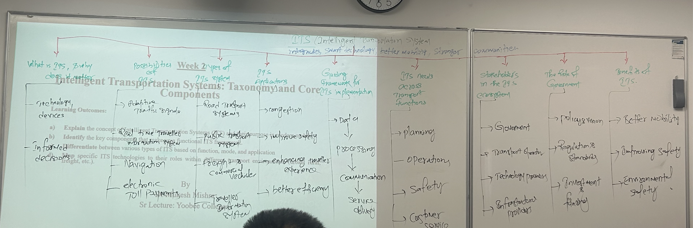

# Week2  
  
  
**智能交通系统（Intelligent Transportation Systems, ITS）** 的课程知识框架与体系结构。  
整体逻辑按照 **“定义与核心概念 $\rightarrow$ 分类与架构 $\rightarrow$ 核心功能/需求 $\rightarrow$ 利益相关者与政府角色 $\rightarrow$ 最终效益”** 主线展开。  
## 1. 投影 PPT 区域（左侧）  
## 标题与课程信息  
* **课程主题**：Intelligent Transportation Systems: Taxonomy and Core Components（智能交通系统：分类与核心组件）  
* 
**讲师**：By Nitesh Mishra, Sr. Lecture, Yoobee College   
* **学习目标 (Learning Outcomes)**：  
    1. 解释智能交通系统（ITS）的概念及其目的 。  
    2. 识别不同功能性 ITS 领域的关键组件 。  
    3. 根据功能、模式和应用区分各种类型的 ITS 。  
    4. 将特定的 ITS 技术与其在不同交通模式（货运等）中的作用相匹配 。  
## 2. 白板手写板书（顶部与中右侧）  
## ① ITS 顶层定义 (Top Bar)  
* 
**定义**：ITS (Intelligent Transportation System) integrates smart technology, better mobility, stronger communities. 
（智能交通系统：整合智能技术，带来更好的流动性与更具韧性的社区 。）
  
## ② 基础与分类 (Left - Middle Branching)  
1. **What is ITS, why does it matter?（什么是 ITS，为何重要？）**  
    * 
**Technology, devices（技术与设备）** $\rightarrow$ **Informed decisions（明智的决策）**   
2. **Possibilities of ITS（ITS 的可能性/应用场景）**  
    * 
**Adaptive traffic signals（自适应交通信号灯）**   
    * 
**Real-time traveller information system（实时出行者信息系统）**   
    * 
**Navigation（导航）**   
    * 
**Electronic toll payment（电子不停车收费/ETC）**   
3. **Types of ITS system（ITS 系统的类型）**  
    * 
**Road transport system（道路交通系统）**   
    * 
**Public transport system（公共交通系统）**   
    * 
**Freight and commercial vehicle（货运与商业车辆）**   
    * 
**Traveller information system（出行者信息系统）**   
4. **ITS Applications（ITS 的具体应用）**  
    * 
**Congestion（缓解拥堵）**   
    * 
**Improve safety（提高安全性）**   
    * 
**Enhancing traveller experience（提升出行体验）**   
    * 
**Better efficiency（更高的运行效率）**   
## ③ ITS 实施指导框架 (Guiding Framework for ITS Implementation)  
数据与控制流程是一个闭环链条：  
  
$$\text{Data (数据)} \longrightarrow \text{Processing (处理)} \longrightarrow \text{Communication (通信)} \longrightarrow \text{Service delivery (服务交付)}$$  
  
## ④ 跨交通职能的 ITS 需求 (ITS Needs Across Transport Functions)  
* **Planning（规划）**  
* **Operations（运营管理）**  
* **Safety（安全）**  
* **Customer service（客户服务）**  
## ⑤ 生态系统中的利益相关者 (Stakeholders in the ITS Ecosystem)  
* **Government（政府）**  
* **Transport operators（交通运营方）**  
* **Technology providers（技术提供商）**  
* **Infrastructure partners（基础设施合作伙伴）**  
## ⑥ 政府的角色 (The Role of Government)  
* **Policy-making（政策制定）**  
* **Regulation & standards（法规与标准）**  
* **Investment & funding（投资与资金支持）**  
## ⑦ ITS 的效益 (Benefits of ITS)  
* 
$\rightarrow$ **Better mobility（更好的流动性/出行效率）**   
* 
$\rightarrow$ **Improving safety（提升安全性）**   
* $\rightarrow$ **Environmental safety / Sustainability（环境安全与可持续性）**  
  
  
